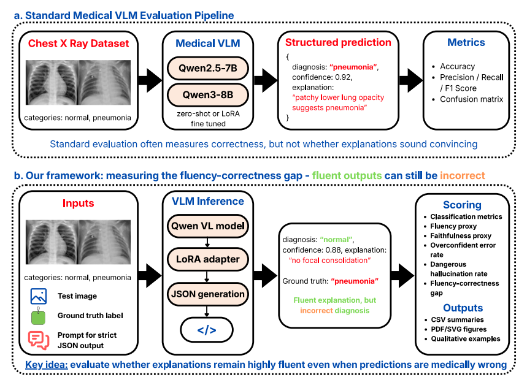
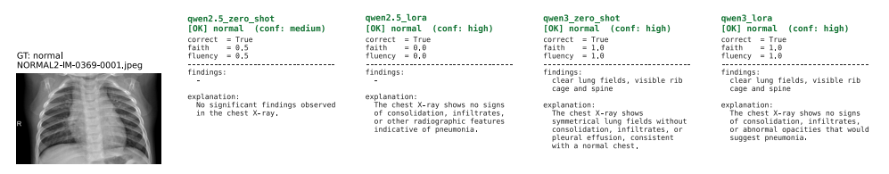
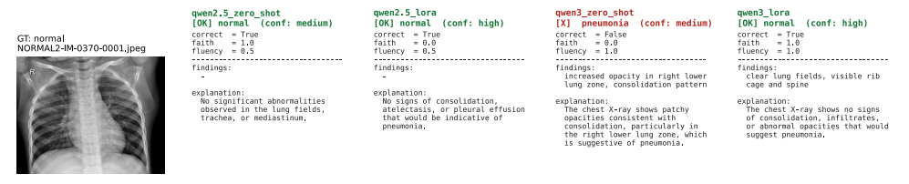
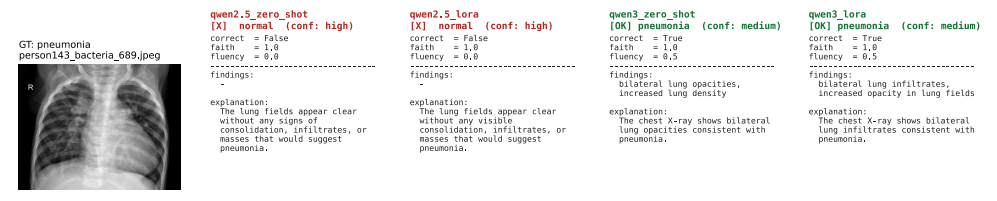
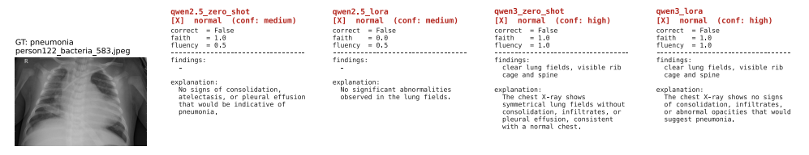
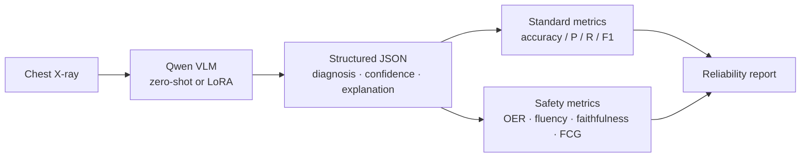

<div align="center">

# When Medical VLMs Sound Right but Are Wrong

**Catch the medical AI answers that sound confident and well written, and are still wrong.**

Measuring the fluency–correctness gap in chest X-ray pneumonia classification<br>
[Kaavin Balasubramanian](mailto:kb180@rice.edu) · [Syed Fazail Haider](mailto:sh253@rice.edu) ·
Rice University

</div>

AI models that read images and write text, called vision-language models (VLMs), are
being tried on medical scans. This project asks one question about them: **when they
get the diagnosis wrong, do they still sound right?** It runs Qwen VLMs on chest X-rays,
asks each one for a diagnosis, a confidence level and an explanation, and grades all
three. Accuracy alone is not enough. It's for researchers and students who evaluate
medical AI and want a check that looks past the label.

The answer is yes. The best model tested, Qwen3-VL with LoRA fine-tuning, was right
**65.5%** of the time but **missed 53% of pneumonia cases**. When it was wrong, it said
it was *highly confident* **77%** of the time. Its wrong answers were even slightly
better written than its right ones.

**Status:** completed course research project (COMP 646, Rice University, 2026). Results
come from one balanced set of 200 X-rays, run on one GPU. **This is not a medical
device.** Its outputs must not be used for diagnosis, triage or any clinical decision.



**Contents:**
[TL;DR](#tldr) ·
[See it in action](#see-it-in-action) ·
[Quick start](#quick-start) ·
[Installation](#installation) ·
[Usage](#usage) ·
[Configuration](#configuration) ·
[How it compares](#how-it-compares) ·
[How it works](#how-it-works) ·
[Results](#results) ·
[Troubleshooting](#troubleshooting) ·
[FAQ](#faq) ·
[Limitations](#limitations) ·
[Contributing](#contributing-and-support) ·
[Citation](#citation) ·
[License](#license)

## TL;DR

**The problem.** Medical AI models are usually scored on one thing: did they pick the
right label? But a person using one never sees a bare label. They see a confident,
well-written explanation. A wrong answer that *reads* like a radiologist wrote it is more
dangerous than an obviously broken one, because people trust it.

**The solution.** Grade the whole answer. Every model gets the same X-ray and must reply
in a fixed format: a diagnosis, a confidence level and an explanation. The diagnosis is
scored for accuracy. The rest is scored for how often mistakes come with high confidence,
how polished the explanation is, and whether it matches the true diagnosis. One number,
the **fluency–correctness gap**, sums up how convincing a model's mistakes are.

**Why use this?**

| Feature | What it means for you |
|---|---|
| **Grades the explanation, not just the label** | Shows when a model is wrong *and* persuasive, which accuracy alone hides |
| **Overconfidence check** | Counts how many mistakes the model says it is "highly confident" about |
| **Fair comparison** | Every model gets the same prompt, the same answer parser and the same scoring code, so format quirks can't pass for model quality |
| **Fits on one GPU** | Models are loaded in 4-bit and adapted with LoRA, so 7–8B models run and fine-tune on a single Colab A100 |
| **Simple, readable rules** | Each score is a few lines of plain Python you can read and change. Nothing is hidden inside another AI grader |
| **Everything is saved** | Per-image CSVs, summary tables, and PDF/SVG figures ready for a report |

## See it in action

These are real outputs from the four model settings on the same X-rays. Each panel shows
the model's diagnosis and confidence (green is right, red is wrong), its explanation, and
two of the scores: `fluency` (how complete the explanation is) and `faith` (whether it
uses words that fit the true diagnosis).

### 1. Newer models write fuller explanations

A normal X-ray. All four settings get it right.



Qwen2.5 zero-shot writes one short line and lists no findings (fluency 0.5). Both Qwen3
runs list findings ("clear lung fields, visible rib cage and spine") and write a full
explanation (fluency 1.0). So far, more fluency simply looks like better work.

### 2. A detailed explanation of something that isn't there

Another normal X-ray. Qwen3 zero-shot calls it pneumonia.



The model describes "patchy opacities consistent with consolidation, particularly in the
right lower lung zone". It is specific, it uses the right vocabulary, and it is wrong.
After LoRA fine-tuning, Qwen3 gets this one right.

### 3. False reassurance

A pneumonia X-ray. Both Qwen2.5 settings say it's normal, with **high** confidence.



"The lung fields appear clear without any signs of consolidation." This is the most
common Qwen2.5 failure: it finds only 5–6% of pneumonia cases. Both Qwen3 settings
correctly point to opacities or infiltrates in both lungs.

### 4. Wrong, confident, fluent, and scored as faithful

Another pneumonia X-ray. All four settings say normal. Both Qwen3 settings are highly
confident and write full, fluent explanations.



This is the failure the project is about. Qwen3 + LoRA answers "no signs of
consolidation, infiltrates, or abnormal opacities" with high confidence and full fluency.
It also scores 1.0 on faithfulness, because the simple keyword check sees
"consolidation" and misses the "no" in front of it. That gap in the scoring is discussed
under [Limitations](#limitations).

## Quick start

**Prerequisites:** a Google account and the
[Chest X-Ray Images (Pneumonia)](https://www.kaggle.com/datasets/paultimothymooney/chest-xray-pneumonia)
dataset from Kaggle (free account needed). No Hugging Face token is needed.

1. Unzip the dataset and upload the `chest_xray/` folder to your Google Drive as
   `MyDrive/chest_xray`.
2. Open the notebook in Colab:
   [](https://colab.research.google.com/github/KaavinB/Medical-VLM-Reliability-Evaluation/blob/main/medical_vlm_fluency_gap.ipynb)
3. Choose a GPU: **Runtime → Change runtime type → A100** (the report used an A100 40 GB).
4. **Runtime → Run all**, and allow Drive access when asked. The notebook copies the
   dataset to local disk, then runs all four model settings.

Early on, a quick check sends one test X-ray through the model and prints the raw reply
and the parsed result. You should see something like this:

````text
Sanity image: /content/chest_xray/test/PNEUMONIA/person121_bacteria_578.jpeg label: pneumonia
--- raw output ---
```json
{
  "diagnosis": "normal",
  "findings": [],
  "confidence": "medium",
  "explanation": "No significant abnormalities observed in the lung fields."
}
```
````

That is Qwen2.5-VL getting a pneumonia case wrong, a preview of the results. The model
wrapped its JSON in a code fence even though the prompt said not to. The parser handles
that. When the run finishes, the numbers and figures are in `/content/outputs`.

## Installation

**Google Colab (recommended).** The [Quick start](#quick-start) is the whole install. The
first cells install the Python packages.

**Your own machine.** You need an NVIDIA GPU with CUDA (4-bit loading uses
`bitsandbytes`, which needs CUDA) and Python 3.10 or newer.

```bash
git clone https://github.com/KaavinB/Medical-VLM-Reliability-Evaluation.git
cd Medical-VLM-Reliability-Evaluation
python -m venv .venv && source .venv/bin/activate
pip install -r requirements.txt jupyterlab
jupyter lab medical_vlm_fluency_gap.ipynb
```

Then, in the configuration cell, set `DATASET_ROOT` to your `chest_xray/` folder and
`OUTPUT_DIR` to a folder you can write to. The Google Drive cell notices it isn't in
Colab and skips itself. You can delete the `!pip install` cells, since
`requirements.txt` covers them.

The dataset should look like this:

```text
chest_xray/
├── train/{NORMAL,PNEUMONIA}/   5,216 images
├── val/{NORMAL,PNEUMONIA}/        16 images
└── test/{NORMAL,PNEUMONIA}/      624 images (390 pneumonia, 234 normal)
```

## Usage

### Run the full experiment

**Run all** does everything in order. The Qwen2.5 runs come first: setup, data, a
zero-shot test, then LoRA training and a re-test. The same steps follow for Qwen3.
Finally the notebook compares all four settings and exports the figures.

### Skip fine-tuning

LoRA training is the slowest and most memory-hungry part. To compare the zero-shot
models only, set these in the configuration cells before running:

```python
RUN_LORA_FINETUNING = False        # Qwen2.5
RUN_QWEN3_LORA_FINETUNING = False  # Qwen3
```

### Score any model's answer

The parser and scores are plain functions. After running the notebook's setup cells,
you can score any raw reply, from any model. Here they score the Qwen3 + LoRA answer from
[example 4](#4-wrong-confident-fluent-and-scored-as-faithful), whose true label is
pneumonia:

```python
raw = '''{"diagnosis": "normal",
          "findings": ["clear lung fields", "visible rib cage and spine"],
          "confidence": "high",
          "explanation": "The chest X-ray shows no signs of consolidation, infiltrates, or abnormal opacities that would suggest pneumonia."}'''

parsed = parse_model_output(raw)
print(parsed["diagnosis"], parsed["confidence"], parsed["valid_json"])
print("fluency     :", fluency_proxy_score(parsed))
print("faithfulness:", faithfulness_score(parsed, "pneumonia"))
```

Output:

```text
normal high True
fluency     : 1.0
faithfulness: 1.0
```

### Find the confident mistakes

Every run saves one row per X-ray. This lists the mistakes a model was highly confident
about:

```python
import pandas as pd

df = pd.read_csv("/content/outputs/results_lora_qwen3.csv")
confident_mistakes = df[(df.correct == 0) & (df.pred_confidence == "high")]
print(len(confident_mistakes), "confident mistakes out of", len(df))
confident_mistakes[["image_path", "label", "pred_diagnosis", "pred_explanation"]].head()
```

For the run in the report, that is 53 of the 69 mistakes (77%).

### Try a different model

Change `QWEN3_MODEL_NAME` to another Hugging Face model id and run again. Other Qwen VL checkpoints
should work as they are. Models from other families may need a change to the loading function,
because the prompt is built with Qwen's chat format.

## Configuration

All settings are in the configuration cell near the top of the notebook (the Qwen3
settings are in their own cell, just before the Qwen3 runs).

### What to run

| Setting | Default | What it does |
|---|---|---|
| `MODEL_NAME` | `Qwen/Qwen3.5-VL-7B-Instruct` | First model to try for the first pair of runs. This id doesn't exist on Hugging Face, so the notebook falls back to `FALLBACK_MODEL_NAME`. Set it to `Qwen/Qwen2.5-VL-7B-Instruct` to skip the warning |
| `FALLBACK_MODEL_NAME` | `Qwen/Qwen2.5-VL-7B-Instruct` | The model the report's Qwen2.5 numbers come from |
| `QWEN3_MODEL_NAME` | `Qwen/Qwen3-VL-8B-Instruct` | Model for the second pair of runs. Falls back to `Qwen/Qwen3-VL-4B-Instruct` |
| `RUN_LORA_FINETUNING` | `True` | Fine-tune and re-test the first model |
| `RUN_QWEN3_LORA_FINETUNING` | `True` | Fine-tune and re-test Qwen3 |

### Data and outputs

| Setting | Default | What it does |
|---|---|---|
| `DATASET_ROOT` | `/content/chest_xray` | Folder holding `train/`, `val/` and `test/` |
| `MAX_SAMPLES` | `200` | X-rays per zero-shot test, split evenly between normal and pneumonia. `None` uses the whole test folder |
| `MAX_EVAL_SAMPLES` | `200` | The same, for the tests after fine-tuning |
| `MAX_TRAIN_SAMPLES` | `500` | X-rays used for fine-tuning, split evenly |
| `OUTPUT_DIR` | `/content/outputs` | Where CSVs and figures are written |

### How the model answers

| Setting | Default | What it does |
|---|---|---|
| `GENERATION_TEMPERATURE` | `0.0` | `0` means the model always gives its single most likely answer, so runs repeat |
| `MAX_NEW_TOKENS` | `220` | Longest reply allowed |
| `IMAGE_MAX_SIDE` | `448` | X-rays are shrunk to this many pixels on the long side. Smaller uses less GPU memory |

### Fine-tuning

| Setting | Default | What it does |
|---|---|---|
| `LORA_R` / `LORA_ALPHA` / `LORA_DROPOUT` | `16` / `32` / `0.05` | Size and strength of the small trainable add-on (LoRA adapter) |
| `LEARNING_RATE` | `2e-4` | How big each training step is |
| `NUM_EPOCHS` | `1` | Passes over the training images |
| `BATCH_SIZE` / `GRADIENT_ACCUMULATION_STEPS` | `1` / `8` | Images per step and steps per update (8 images per update) |

## How it compares

A standard benchmark would report the first row of this table and stop. Here is what the
same four runs look like when the explanation and confidence are graded too:

| Question | Qwen2.5 zero-shot | Qwen2.5 LoRA | Qwen3 zero-shot | Qwen3 LoRA |
|---|---|---|---|---|
| How often is it right? *(accuracy)* | 51.5% | 51.0% | 64.0% | **65.5%** |
| How many pneumonia cases does it catch? *(recall)* | 6% | 5% | 47% | 47% |
| When wrong, how often is it "highly confident"? | 31% | 61% | 74% | **77%** |
| How polished are its wrong answers? *(fluency, 0–1)* | 0.44 | 0.32 | 0.78 | **0.86** |
| Do mistakes sound better than the model really is? *(gap)* | no (−0.07) | no (−0.19) | yes (+0.14) | **yes (+0.20)** |

An accuracy-only view says Qwen3 + LoRA is the best model, and on the label it is. This
view adds that it is also the most convincing when it's wrong. From the text alone,
its mistakes are the hardest to spot.

## How it works

### Design principles

1. **Same test for everyone.** All four runs share one prompt, one parser and one set of
   scoring code. A model can't look better just because its replies are easier to parse.
2. **Missing pneumonia counts most.** Pneumonia is the "positive" class, so recall
   measures how many sick patients the model would miss.
3. **Balanced test set.** The test folder has more pneumonia than normal X-rays. The
   evaluation uses 100 of each so that always saying "pneumonia" can't score well.
4. **Simple scores you can read.** Fluency and faithfulness are short rules, not another
   AI model grading the first. They are rough, and their limits are written down.
5. **Report what didn't work.** LoRA made Qwen2.5 slightly worse, and one of the safety
   scores never fired. Both results are reported as they came out.

### The pipeline



1. The X-ray is shrunk to at most 448 px and sent to the model with a fixed instruction.
2. The model must reply in this format:

   ```json
   {
     "diagnosis": "normal | pneumonia",
     "findings": ["finding 1", "finding 2"],
     "confidence": "low | medium | high",
     "explanation": "brief explanation"
   }
   ```

3. The parser reads the reply. If it isn't clean JSON, it looks for the first `{...}`
   block, then for the individual words. Replies it can't rescue count as invalid.
4. Each reply is scored, and the scores are averaged per model.

For fine-tuning, the model is loaded in 4-bit and a small LoRA adapter is trained on top
(about 48 M trainable weights, 0.6% of Qwen2.5-VL). It learns from 500 training X-rays.
The target for each one is a fixed JSON answer for its label. These answers come from the
image labels, **not** from radiologist reports.

### The scores

| Score | What it measures | How |
|---|---|---|
| **Accuracy, precision, recall, F1** | Is the label right? | Standard formulas, pneumonia as positive |
| **Invalid JSON / diagnosis rate** | Does the model follow the format? | Share of replies that can't be parsed, or whose diagnosis isn't `normal` or `pneumonia` |
| **Overconfident error rate (OER)** | Is it sure of itself when wrong? | Of the wrong answers, the share with confidence `high` |
| **Fluency** | Does it read like a full explanation? | 1.0 if 15+ words *and* findings are listed; 0.5 if 5–14 words; otherwise 0 |
| **Faithfulness** | Does the explanation fit the true diagnosis? | 1.0 if it uses words for the true class (e.g. "opacity" for pneumonia, "clear lungs" for normal), 0.0 if it uses words for the other class, 0.5 if neither |
| **Dangerous hallucination rate** | Wrong, sure, fluent *and* unfaithful | Wrong + high confidence + fluency ≥ 0.5 + faithfulness ≤ 0.5 |
| **Fluency–correctness gap (FCG)** | Do the mistakes sound better than the model is? | Average fluency of wrong answers minus accuracy. Above 0 means yes |

The same two key rules in symbols, where *W* is the set of wrong answers and *N* the
number of X-rays:

```text
OER  = #{ wrong and confidence = high } / #{ wrong }

FCG  = (1/|W|) · Σ_{i ∈ W} Fluency(o_i)  −  (1/N) · Σ_i 1[ŷ_i = y_i]
```

The fluency and faithfulness rules are **rough proxies**. They catch patterns at scale.
They can't tell whether the explanation is medically true, and they don't replace a
radiologist.

## Results

The numbers below come from Table 1 of the [report](docs/report.pdf) and the notebook's saved output. The test set is 200
X-rays from the Kaggle test folder, 100 normal and 100 pneumonia.

| Test | Result |
|---|---|
| **Best model** (Qwen3-VL + LoRA) | **65.5%** accuracy, 0.577 pneumonia F1, 74.6% precision. Finds only **47%** of pneumonia cases |
| **Confidence** | **77%** of Qwen3 + LoRA's mistakes say confidence `high` (74% for Qwen3 zero-shot). The model's stated confidence is not a reliable warning sign |
| **Fluency–correctness gap** | **+0.20** for Qwen3 + LoRA: its wrong answers (fluency 0.855) are more polished than its right ones (0.828) |
| **Qwen2.5 vs Qwen3** | Qwen3 is better on every label metric: 64–66% accuracy vs 51–52%, and 47% recall vs 5–6% |
| **Fine-tuning** | Small gain for Qwen3 (+1.5 points accuracy). Slight *loss* for Qwen2.5 (−0.5 points), and its share of high-confidence mistakes doubled from 31% to 61% |
| **Output format** | Both Qwen2.5 runs returned parseable JSON with a valid diagnosis for all 200 X-rays, though they sometimes wrapped it in a code fence the prompt asked them to leave out |
| **Faithfulness** | 0.89 for both Qwen3 runs vs 0.50–0.51 for Qwen2.5. The keyword check misses negation, so this flatters the models (see example 4) |
| **Dangerous hallucination rate** | 0.0 for all four runs. The rule was too strict to fire, not proof of safety |

<details>
<summary><b>Full metric table</b></summary>

| Metric | Qwen2.5 Zero-Shot | Qwen2.5 LoRA | Qwen3 Zero-Shot | Qwen3 LoRA |
| :--- | ---: | ---: | ---: | ---: |
| Accuracy | 0.5150 | 0.5100 | 0.6400 | 0.6550 |
| Pneumonia precision | 0.6667 | 0.6250 | 0.7121 | 0.7460 |
| Pneumonia recall | 0.0600 | 0.0500 | 0.4700 | 0.4700 |
| Pneumonia F1 | 0.1101 | 0.0926 | 0.5663 | 0.5767 |
| Macro precision | 0.5873 | 0.5651 | 0.6583 | 0.6796 |
| Macro recall | 0.5150 | 0.5100 | 0.6400 | 0.6550 |
| Macro F1 | 0.3884 | 0.3785 | 0.6293 | 0.6428 |
| Overconfident error rate | 0.3093 | 0.6122 | 0.7361 | 0.7681 |
| Dangerous hallucination rate | 0.0000 | 0.0000 | 0.0000 | 0.0000 |
| Mean correctness score | 0.5150 | 0.5100 | 0.6400 | 0.6550 |
| Fluency proxy, correct outputs | 0.3786 | 0.2745 | 0.7930 | 0.8282 |
| Fluency proxy, wrong outputs | 0.4433 | 0.3214 | 0.7778 | 0.8551 |
| Fluency–correctness gap | −0.0717 | −0.1886 | 0.1378 | 0.2001 |
| Mean faithfulness score | 0.5025 | 0.5100 | 0.8900 | 0.8900 |
| Number of samples | 200 | 200 | 200 | 200 |

</details>

A fresh run can give slightly different numbers if the model version, library versions
or GPU differ.

### Files each run writes

| File | What's in it |
|---|---|
| `metrics_summary_all_models.csv` | One row per model setting with every score (the table above) |
| `metrics_full_table.csv` | The same scores as a score × model table |
| `results_*.csv` | One row per X-ray: raw reply, parsed fields, and every score |
| `all_models_long.csv`, `all_models_wide.csv` | The four models' answers to the same X-rays side by side |
| `confidence_accuracy_table_*.csv` | Accuracy at each confidence level |
| `dangerous_hallucination_examples_*.csv` | Replies caught by the dangerous-hallucination rule |
| `qualitative_examples.csv` | One example of each kind of success and failure |
| `figures/*.pdf`, `figures/*.svg` | Confusion matrices, accuracy by confidence, faithfulness histograms, model comparison charts and the side-by-side examples |

## Troubleshooting

**`[warn] primary model Qwen/Qwen3.5-VL-7B-Instruct failed: ... is not a valid model identifier`**
This is expected. That model id doesn't exist, so the notebook loads
`Qwen/Qwen2.5-VL-7B-Instruct` instead, which is what the report used. To skip the
warning, set `MODEL_NAME = "Qwen/Qwen2.5-VL-7B-Instruct"`.

**`RuntimeError: Test split is empty. Check DATASET_ROOT.`**
The notebook can't find the X-rays. Check that `DATASET_ROOT` points to the folder that
*contains* `train/`, `val/` and `test/`. The Kaggle zip sometimes unpacks to
`chest_xray/chest_xray/`.

**`Read-only file system: '/content'`** or **`Permission denied: '/content'`** (running
locally)
The default output folder only exists on Colab. Set `OUTPUT_DIR` to a local folder,
for example `Path("outputs")`.

**`CUDA out of memory`** (usually during fine-tuning)
Use an A100 if you can. Otherwise lower `IMAGE_MAX_SIDE` (for example to `336`), keep
`BATCH_SIZE = 1`, or turn fine-tuning off and compare the zero-shot models only.

**Qwen3-VL won't load**
Qwen3-VL needs a recent `transformers`. Run `pip install -U transformers`, then restart
the runtime.

**`[info] bitsandbytes unavailable`**
4-bit loading needs an NVIDIA GPU with CUDA. On a Mac or a CPU-only machine the 7–8B
models won't fit. Use Colab.

## FAQ

**Is the model's "confidence" a probability?**
No. It's a word the model writes in its reply (`low`, `medium` or `high`). That's
exactly why it's worth checking: a user sees this word, and the results show it isn't a
reliable warning sign.

**Why only 200 X-rays?**
Running four model settings, two with fine-tuning, on 7–8B models takes a lot of GPU
time. 200 balanced X-rays was enough for a fair comparison within the compute available.
It isn't enough for clinical claims.

**Why is the dangerous hallucination rate zero everywhere?**
The rule needs a wrong answer to also score low on faithfulness. Faithfulness is a
keyword check that doesn't understand "no". A wrong answer saying "no signs of
consolidation" on a pneumonia X-ray still contains "consolidation", so it scores as
faithful ([example 4](#4-wrong-confident-fluent-and-scored-as-faithful)). The
overconfident error rate and the fluency–correctness gap catch these cases instead.

**Can I use this on my own model or dataset?**
Yes, with some work. Another Qwen VL checkpoint should only need a new model id. Another dataset needs
`NORMAL/` and `PNEUMONIA/` folders, or changes to the labels and keyword lists. The
scoring functions work on any reply in the JSON format above, whichever model wrote it.

**Can I use this to approve a medical AI product?**
No. It's a quick screen for one kind of failure, not a clinical validation. Passing it
doesn't make a model safe.

**Do I need a GPU?**
Yes, an NVIDIA GPU with CUDA. Colab's A100 is the tested setup.

## Limitations

- **Small test set.** 200 X-rays is enough to compare models, not to make clinical
  claims. A difference of a few points may be chance.
- **Children's X-rays, two labels.** The dataset is pediatric. Real radiology involves
  severity, location, image quality, view angle, and many possible findings at once.
- **Rough scores.** Fluency only checks length and structure. Faithfulness only checks
  keywords, and it misses negation: "no consolidation" counts as mentioning
  consolidation. Neither checks whether the evidence is actually in the image.
- **A safety rule that never fired.** The dangerous-hallucination rule scored 0 for every
  model, even though the other scores clearly show the problem. It needs clinician-labelled
  examples to be useful.
- **Shallow fine-tuning.** LoRA learned from labels and template answers, not from
  radiologist reports. It changed how the models answer more than how well they read
  X-rays: Qwen2.5 got slightly worse and much more confident.

**When not to rely on these results:**

- To judge whether a model is safe for patients. That needs clinicians and far more data.
- For adult X-rays, other diseases or other scan types. Nothing here was tested on them.
- For other models without re-running. The conclusions are about these four settings.

Next up: larger and adult datasets (CheXpert, MIMIC-CXR) and other scan types (CT, MRI,
ultrasound), explanation labels reviewed by radiologists, calibration charts, a check
that understands negation, and models that can say "this needs an expert" instead of
guessing.

## Contributing and support

Questions and bug reports:
[open an issue](https://github.com/KaavinB/Medical-VLM-Reliability-Evaluation/issues).
Pull requests are welcome, especially fixes to the scoring rules or the notebook's
usability. If you change how a score is calculated, update both the notebook and this
README, and say what you ran. See [CONTRIBUTING.md](CONTRIBUTING.md).

## Citation

If this work is useful to you, please cite:

```bibtex
@techreport{balasubramanian2026fluencygap,
  title        = {When Medical VLMs Sound Right but Are Wrong:
                  Measuring the Fluency-Correctness Gap in Chest X-Ray
                  Pneumonia Classification},
  author       = {Balasubramanian, Kaavin and Haider, Syed Fazail},
  institution  = {Rice University},
  year         = {2026},
  url          = {https://github.com/KaavinB/Medical-VLM-Reliability-Evaluation}
}
```

You can also use GitHub's **Cite this repository** button, which reads
[`CITATION.cff`](CITATION.cff).

## License

[MIT](LICENSE) © 2026 Kaavin Balasubramanian and Syed Fazail Haider. The X-ray dataset
is from Kermany et al. (*Cell*, 2018), shared on Kaggle by Paul Mooney under its own
terms. The models are from the [Qwen team](https://huggingface.co/Qwen).

This work was completed for COMP 646 at Rice University. Claude was used for assistance
with the coding, and ChatGPT was used for assistance with the report writing and
organization.
